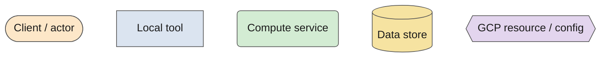
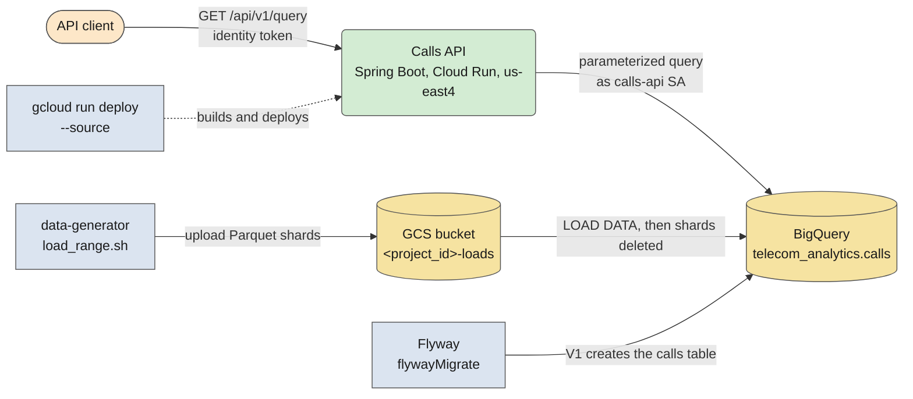
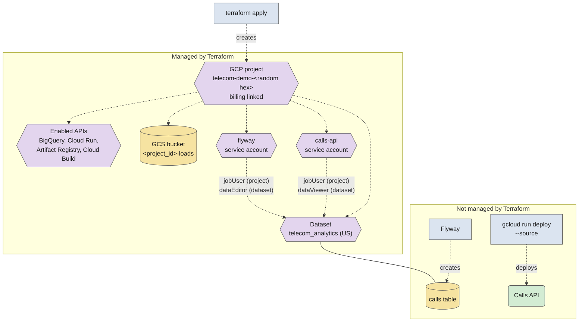
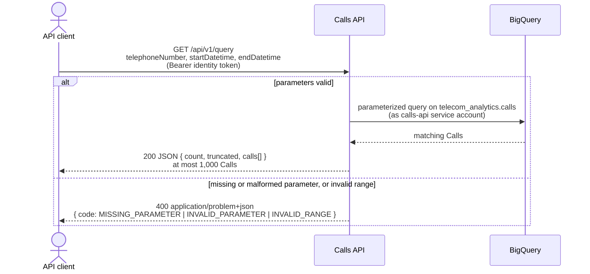

# gcp-cloud-run-big-query-template

A **strictly non-production prototype** that explores BigQuery and Cloud Run for telecom analytics. See `GLOSSARY.md` for domain terms.

> Work in progress. This README is updated as the project is built.

## Purpose

- A BigQuery table of phone **Calls** (`telecom_analytics.calls`), seeded with generated data and later managed by Flyway.
- A stateless Cloud Run API (Spring Boot, Java 21) that turns structured requests into parameterized BigQuery queries and returns results synchronously.

## Architecture

Three diagrams: the running system, how Terraform sets up the project, and what a client request does. They share one legend, so a component keeps its shape and colour in every diagram.

Solid arrows are data flow; dotted arrows are provisioning, deploy or grants. In the sequence diagram the participants carry the same names as the legend.

### Components

What exists at runtime and how Calls get in and out.

### Provisioning

`terraform apply` creates the throwaway project and everything around it; the `calls` table and the Cloud Run service are not Terraform's. Details: [docs/gcp/terraform.md](docs/gcp/terraform.md).

### Client request flow

A lookup is one synchronous request. Validation errors never reach BigQuery.

## Status

Planning is done; the decisions are summarized in [docs/spec.md](docs/spec.md). The build is tracked in a second GitHub issue map (label `wayfinder:map`). Built so far: Terraform, the Flyway V1 migration and the seed data generator.

## Planned layout

| Path | Contents |
|---|---|
| `api/` | Spring Boot API (Gradle, single module) |
| `flyway/` | Flyway Gradle project and `sql/V1__create_calls.sql` |
| `data-generator/` | Python generator and loader for synthetic Calls (Parquet) |
| `terraform/` | Terraform for the throwaway GCP project |
| `docs/gcp/` | GCP project and service account setup |
| `docs/adr/` | Architecture decision records |

## API

`GET /api/v1/query` with `telephoneNumber`, `startDatetime`, `endDatetime`; `GET /health`.

Usage examples, parameters, response and error shapes: [docs/api-usage.md](docs/api-usage.md). Deploy and teardown: [docs/gcp/api-deployment.md](docs/gcp/api-deployment.md).

## Setup

- Terraform (recommended): [docs/gcp/terraform.md](docs/gcp/terraform.md)
- API deploy and teardown: [docs/gcp/api-deployment.md](docs/gcp/api-deployment.md)
- Manual alternative: [GCP project setup](docs/gcp/project-setup.md), [API service account](docs/gcp/api-service-account.md)

## Loading seed data

Generate and load synthetic Calls into BigQuery with `data-generator/load_range.sh`: [docs/data-loading.md](docs/data-loading.md).

## Teardown

- Terraform: `terraform -chdir=terraform destroy`, then the local cleanup in [docs/gcp/terraform.md](docs/gcp/terraform.md#teardown)
- Manual: see the Teardown section of [project-setup.md](docs/gcp/project-setup.md#teardown)
